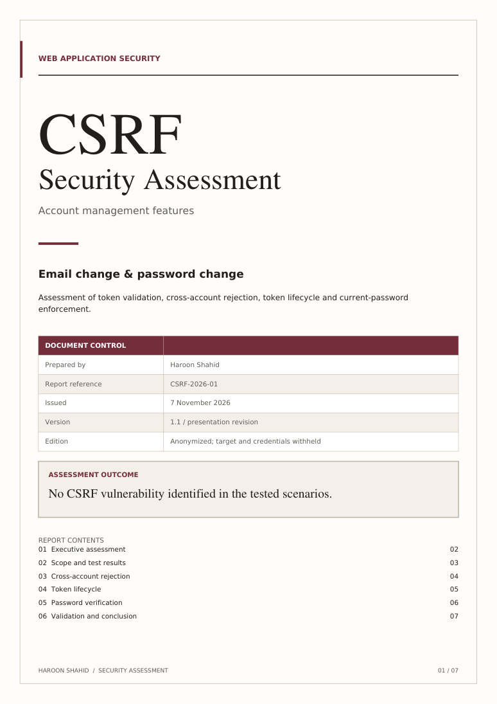

# Account Management CSRF Assessment

**Assessor:** Haroon Shahid  
**Test date:** 7 November 2026, based on captured UTC response timestamps  
**Target:** Anonymized web application  
**Result:** No CSRF vulnerability identified in the tested scenarios

[Read the report](CSRF_Account_Management_Assessment.pdf) · [Download the report and evidence package](CSRF_Assessment_Evidence_Package.zip)

## What I tested

- Email-change requests with missing, empty, arbitrary, modified and cross-account CSRF tokens.
- Reuse of the current token before a page reload, and rejection of the old token after reload.
- Acceptance of a replacement token in the retained authenticated session.
- Password-change responses with correct and incorrect current passwords.
- An email-change request converted from POST to GET.

## Main observations

The email-change endpoint rejected the tested invalid-token cases. A token from Account B was rejected with Account A's authenticated request. **Both tokens were valid at the time of that test**, as confirmed in the testing record.

The current email token was accepted repeatedly before reload. After reload, the old token was rejected and the replacement succeeded. This corrected the initial single-use-token hypothesis. Token reuse alone was not treated as a vulnerability.

Password-change captures show a success response with the correct current password and rejection with an incorrect one. The full email CSRF test matrix was not independently established for the password workflow.

## Evidence

| Evidence | Observation |
| --- | --- |
| [E04](evidence/E04.png) | Valid-token email baseline accepted |
| [E05](evidence/E05.png) | Missing token rejected |
| [E06](evidence/E06.png) | Arbitrary token rejected |
| [E09](evidence/E09.png) | Cross-account token rejected |
| [E10](evidence/E10.png), [E11](evidence/E11.png) | Same token accepted twice before reload |
| [E12](evidence/E12.png) | Old token rejected after reload |
| [E14](evidence/E14.png) | Replacement token accepted |
| [E16](evidence/E16.png) | Password-change success response |
| [E17](evidence/E17.png) | Incorrect current password rejected |
| [E18](evidence/E18.png) | Tested GET request rejected |

The figures contain original response excerpts. Request summaries in the report use aliases in place of secrets. The [evidence manifest](evidence_manifest.json) maps each excerpt to its original screenshot number and source SHA-256 hash. Raw screenshots and the source conversation are excluded because they contain sensitive information.

## Assessment limits

Most results are supported by application response bodies; independent persisted-state or subsequent-login verification was not supplied for every test. No cross-site browser exploit was demonstrated. Token entropy, same-user cross-session binding, independent Origin/Referer enforcement and SameSite behavior were not established.

The report distinguishes screenshot evidence from the assessor's written observations. It does not claim a complete penetration test or a confirmed vulnerability.
