# Proantic - CSRF Account Management Assessment

**No CSRF vulnerability found in the tested cases.**

This report records my email-change and password-change testing on Proantic. It contains the full original screenshots and explains each test in simple English.

**Publication status:** The complete illustrated PDF is prepared. Its public upload is pending approval. The assessment below contains 10 approved full-frame screenshots; the remaining image entries are clearly marked.

## Target and scope

| Item | Detail |
| --- | --- |
| Tester | Haroon Shahid |
| Target | https://www.proantic.com |
| Captured test date | 7 November 2026 (GMT / UTC) |
| Tools | Burp Suite and Chrome DevTools |
| Email page | `/en/monespace.php?mode=email` |
| Password page | `/en/monespace.php?mode=pwd` |
| Update endpoint | `POST /script/member/script-modifier-member-ajax-csrf.php` |
| Main test account | `Account A`, later `Account A (updated email)` |
| Second test account | `Account B` |

## Simple terms

- **Request:** A message that the browser sends to the website, such as "change my email".

- **Response:** The website's answer to that message.

- **Session:** The login that the website recognises from the browser's cookies.

- **CSRF token:** A hidden value sent with the form. The website checks whether it is valid for the request.

- **Working comparison:** A normal request that succeeds. I compare edited requests against it.

## How I tested

1. **Open the feature.** I opened the email-change page while logged in to my test account.

2. **Check a normal update.** A normal browser request returned success. An early replay of a request from HTTP history returned a token error.

3. **Capture before sending.** I intercepted a fresh request, sent it to Burp Repeater, then dropped the browser request. The fresh request worked in Repeater.

4. **Change one input at a time.** I kept the login cookies and edited the token. I tried an empty value, no token, an arbitrary value and a one-character change.

5. **Compare two accounts.** I put the second account's token into the main account's request. I also checked repeated use before reload and old/new tokens after reload.

6. **Check the other cases.** I tested the password form with correct and incorrect current passwords. I also sent an email-change request using GET instead of POST.

**Reading the response:** HTTP 200 means the server answered. It does not mean the change worked. I read the success or error message in the response body.

## All results

| What I tested | What the site returned | Evidence |
| --- | --- | --- |
| Normal email request | Success response | E04 |
| Empty email token | Security error | Written notes |
| Email token removed | Security error | E05 |
| Token set to invalid123 | CSRF token error | E06 |
| One token character changed | CSRF token error | Written notes |
| Main login + other account's token | CSRF token error | E07-E09 + notes |
| Same token sent twice, no reload | Both returned success | E10, E11 |
| Old token sent after reload | CSRF token error | E12 |
| New token sent after reload | Success response | E13, E14 |
| Correct current password | Password success response | E15, E16 |
| Incorrect current password | Current-password error | E17 |
| Password token reuse / reload | Same pattern reported | Written notes |
| Email request changed to GET | Security error; see limit | E18 |

**Main lesson:** the same token worked more than once before reload. After reload, the old token failed and the new token worked. It was reusable, not single-use.

## Full evidence and explanations

Every published image below retains the complete uploaded screenshot frame at its original dimensions. Sensitive values are blurred. 6 image files are pending publication approval. E-numbers match the original screenshot numbers. Some headers were already collapsed in Burp when the screenshots were captured. The request-text appendix preserves additional headers from the written notes.

### E03 - I opened the email-change form.

**What I did:** I opened the account page at /en/monespace.php?mode=email. The main test account showed Account A.

**What the website said:** The page offered a field for a new email address and an OK button.

**What this means:** This identifies the first feature I tested. The account email later changed during testing.

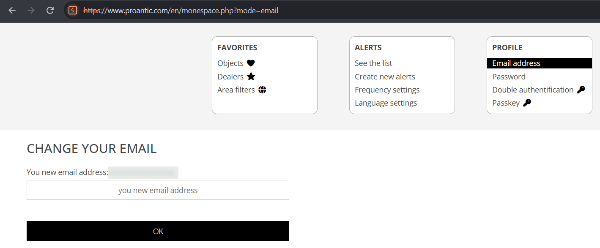

### E04 - A normal request worked.

**What I did:** I sent a POST request with the main account's cookies and its valid csrf-token. The requested email was Account A (updated email).

**What the website said:** The response body said: "Your email address has been updated."

**What this means:** This gave me a working request to compare with the edited requests. A later browser screenshot also shows Account A (updated email).

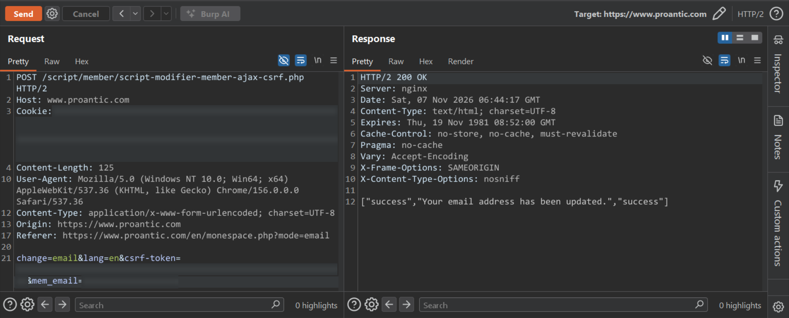

### E05 - Removing the token failed.

**What I did:** I removed the entire csrf-token parameter and sent the email-change request with the same logged-in context.

**What the website said:** The response body said: "Erreur Security 1". The application rejected the request.

**What this means:** Leaving out the token did not bypass the check. In a separate check in my written notes, an empty token returned the same error.

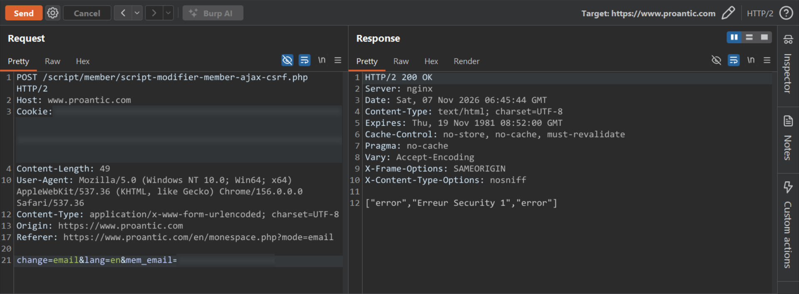

### E06 - A made-up token failed.

**What I did:** I replaced the real token with invalid123 and sent the request.

**What the website said:** The response body said: "Error CSRF Token".

**What this means:** A token field containing any random text was not enough. My written notes also record rejection after changing one character of a real token.

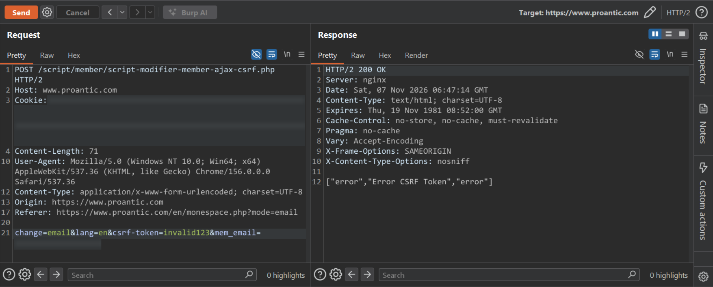

### E07 - I found the main account's token.

**What I did:** I inspected the email form in Chrome DevTools while using the main account, Account A.

**What the website said:** The page contained a hidden input named csrf-token. Its value is blurred in this public screenshot.

**What this means:** This links the main account's email form to the token used in its working requests. This page alone does not show a new successful submission.

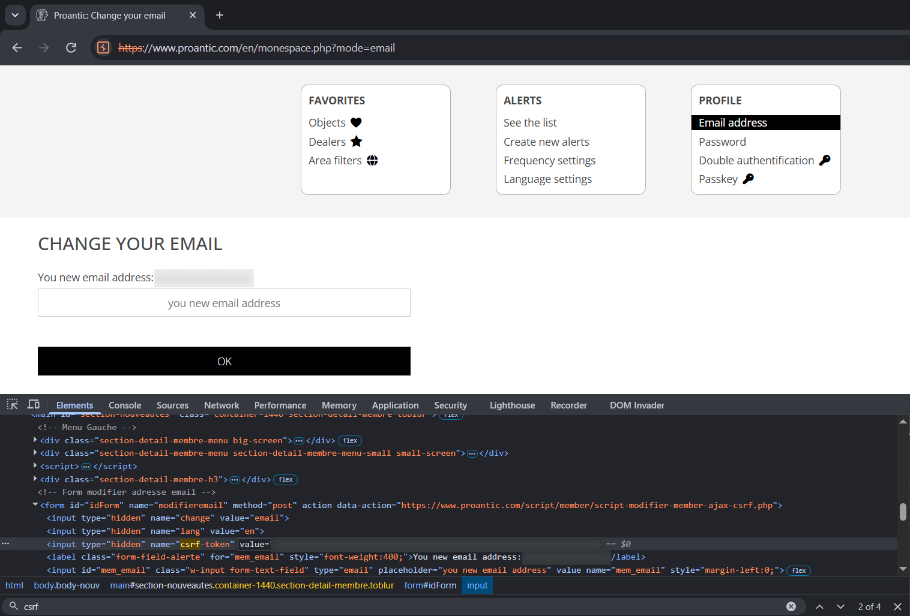

### E08 - I found the second account's token.

**What I did:** I opened the email form for my second test account, Account B, and inspected its hidden token.

**What the website said:** This account had a different csrf-token value.

**What this means:** I now had tokens from two different account contexts. I confirmed in my testing notes that both were still valid during the substitution test.

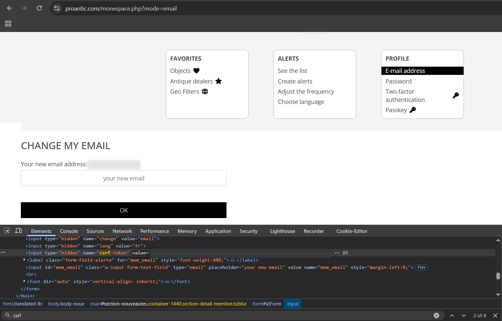

### E09 - The other account's token failed.

**What I did:** I kept the main account's login cookies and replaced only its token with the second account's token. Neither form was reloaded.

**What the website said:** The response body said: "Error CSRF Token".

**What this means:** The other account's token did not authorise this request. Both-token validity is confirmed in my notes; a separate successful second-account request was not captured.

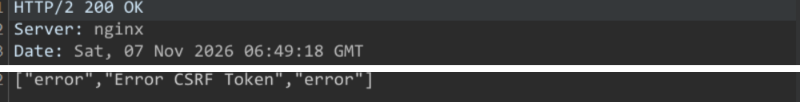

### E10 - The token worked before reload.

**What I did:** I sent an email-change request with the main account's valid token and did not reload the account page.

**What the website said:** The response body reported a successful email update at 06:52:26 GMT.

**What this means:** This is the first request in the token-reuse comparison. The next screenshot shows the same token being accepted again.

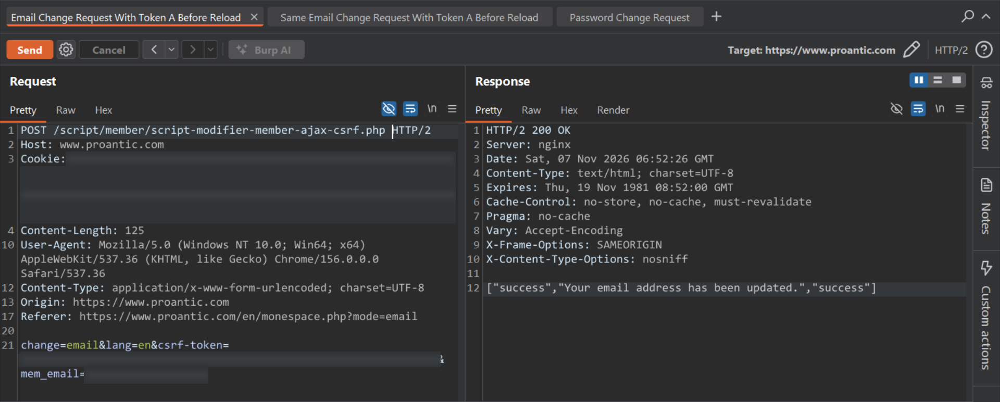

### E11 - The same token worked again.

**What I did:** I sent another request with the same token and login cookies, without reloading the page.

**What the website said:** The response again reported a successful email update, at 06:52:54 GMT.

**What this means:** The token was reusable. This corrected the earlier idea that every successful request consumed the token. Two success responses are shown; this second screenshot alone does not prove another stored email change.

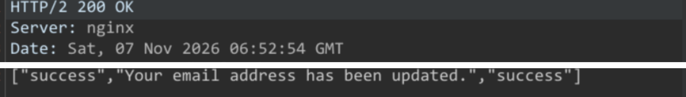

### E12 - The old token failed after reload.

**What I did:** I reloaded the account page, then sent the earlier request again while keeping the main account's session.

**What the website said:** The old token returned "Error CSRF Token" at 06:56:37 GMT.

**What this means:** The old value was no longer accepted after reload. This is different from the token becoming invalid after one use.

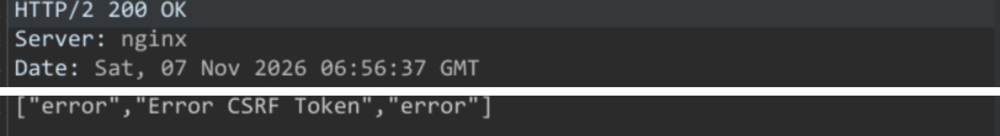

### E13 - The page showed a new token.

**What I did:** After reload, I inspected the email form again in Chrome DevTools.

**What the website said:** The page showed Account A (updated email) and a token different from the earlier one.

**What this means:** The browser view supports the email update and shows the replacement token. The next request checks whether this new value works.

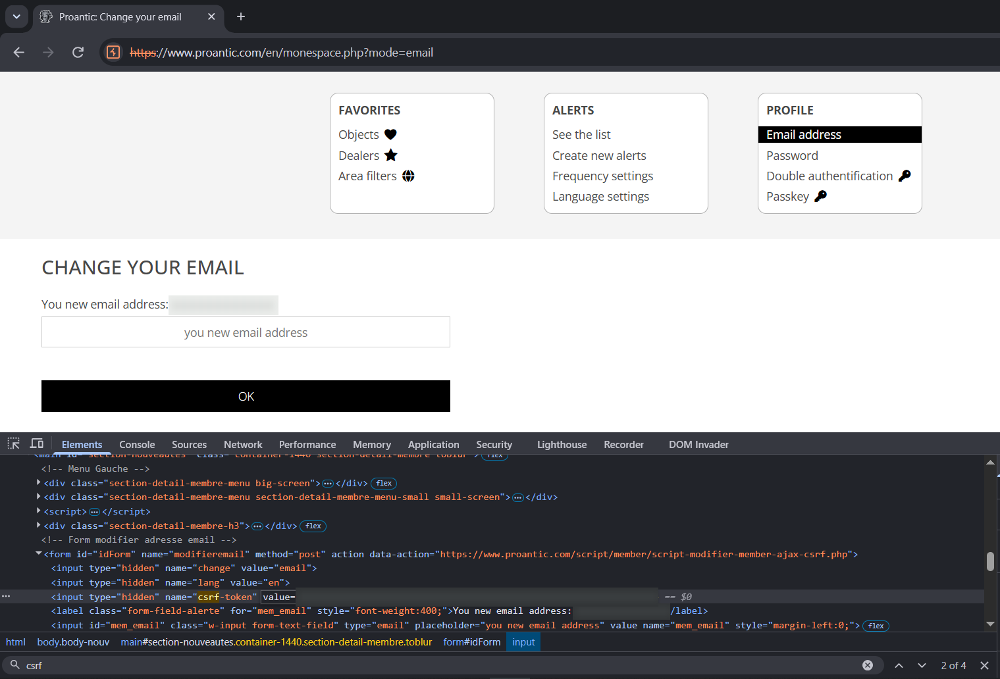

### E14 - The new token worked.

**What I did:** I kept the same main-account session and used the replacement token from the reloaded page.

**What the website said:** The response reported a successful email update at 06:58:28 GMT.

**What this means:** The old token failed, but the replacement worked. Together, these tests support token replacement when the page was reloaded. They do not reveal the server's internal code.

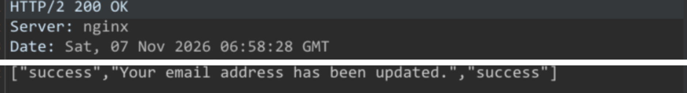

### E15 - I opened the password form.

**What I did:** I opened /en/monespace.php?mode=pwd and inspected the form.

**What the website said:** The form asked for Current password, New password and Confirm your new password. It also included a hidden csrf-token.

**What this means:** The password action had an extra input to check: the current password. It used the same update endpoint with change=pwd.

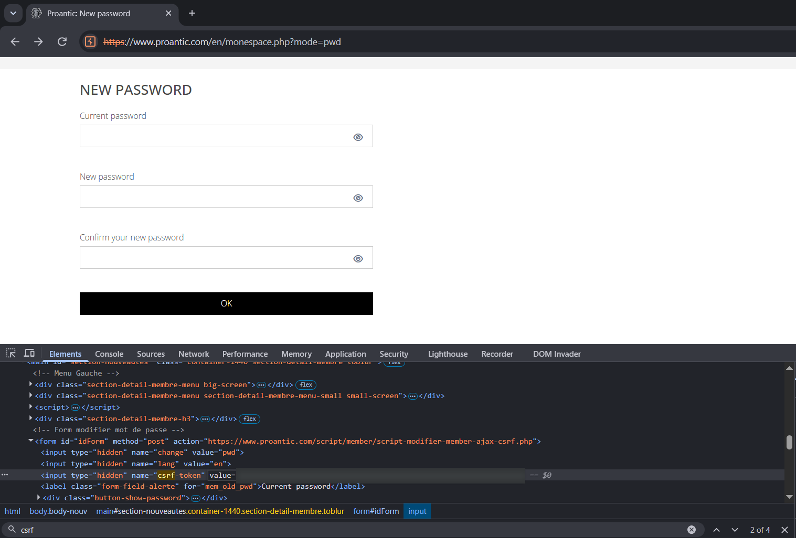

### E16 - The correct current password worked.

**What I did:** I sent the password-change request using the correct current password, a token and matching new-password fields.

**What the website said:** The response body said: "Your password has been changed."

**What this means:** The application reported that the normal password update worked. A separate logout-and-login check with the new password was not included in the evidence.

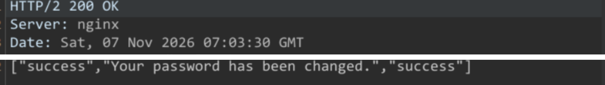

### E17 - An incorrect current password failed.

**What I did:** I checked a request whose current-password value was incorrect for the account at that point in the test.

**What the website said:** The response said: "The Current Password is not correct." The old Repeater tab title still says Correct Current Password; the result is the error on the right.

**What this means:** The current-password check rejected this request. After a successful password change, the old password is no longer current. This error alone says nothing about whether the token was still valid.

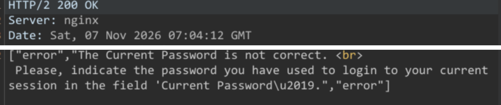

### E18 - The tested GET request failed.

**What I did:** I changed the email request from POST to GET and moved the form fields into the URL query string.

**What the website said:** The response body said: "Erreur Security 1".

**What this means:** This GET request was rejected. Its token also appears in the password-form evidence. No successful email POST with that exact token is shown, so this does not isolate a method-only check.

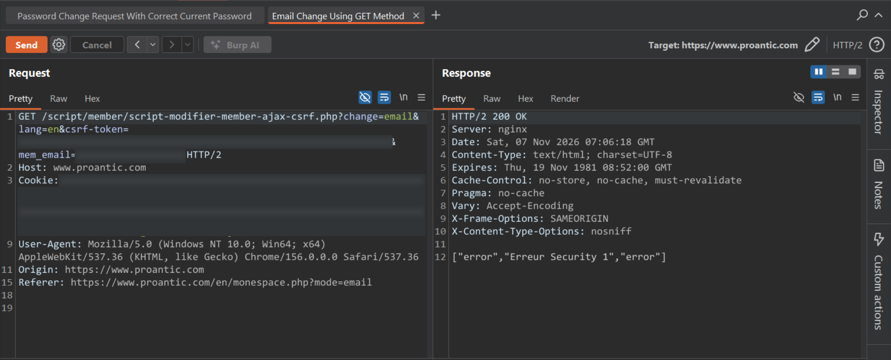

## Final assessment

No CSRF vulnerability found in the tested cases.

The email checks rejected the attempted token bypasses. The repeated-use and reload tests support token replacement on page reload. The password feature rejected an incorrect current password. These results do not establish the security of the whole site.

No confirmed vulnerability, exploit impact or CVSS score is assigned.

## What was not established

- **Cross-site browser attack:** No successful attack page on a different site was demonstrated.

- **Other browser protections:** Origin, Referer, SameSite cookies and X-Requested-With enforcement were not separately established.

- **Exact token binding:** The other account's token failed. Two separate logins of the same account were not tested, so account binding and session binding cannot be separated.

- **Password token coverage:** Token reuse and reload behaviour were reported for the password feature. Separate missing, empty, invalid and other-account token screenshots were not supplied for that feature.

- **Saved account state:** Most captures show response messages. E13 also shows the updated email in the browser. A new-login check after the password update was not supplied.

- **Server implementation:** The tests do not reveal token storage, generation quality, validation order or every event that can replace a token.

**GET test limit:** the token in E18 also appears in the password-form evidence. No successful email POST with that exact token was shown. The request failed, but the reason was not isolated.

**Token reuse:** reuse alone is not a vulnerability. OWASP describes token designs that allow reuse during a login session.

## Full requests from the notes

These are earlier request captures from the supplied test log, not transcriptions of the later screenshots. PDF line wraps were joined. Header and form-field names are retained. Sensitive values use labels. Original Content-Length headers are retained; placeholder lengths differ. These are public transcriptions, not original network files.

### Full email request from the notes

[Download the request text](Requests/Email_Change_From_Notes.http)

```http
POST /script/member/script-modifier-member-ajax-csrf.php HTTP/2
Host: www.proantic.com
Cookie: cookie_analytic=[COOKIE_VALUE]; _ga=[COOKIE_VALUE]; mem_form_email=[COOKIE_VALUE]; PHPSESSID=[COOKIE_VALUE]; mem_id=[COOKIE_VALUE]; memsid=[COOKIE_VALUE]; _ga_YP51KSLLWR=[COOKIE_VALUE]
Content-Length: 125
Sec-Ch-Ua-Platform: "Windows"
Accept-Language: en-US,en;q=0.9
Sec-Ch-Ua: "Not:A-Brand";v="8", "Chromium";v="156"
Sec-Ch-Ua-Mobile: ?0
X-Requested-With: XMLHttpRequest
User-Agent: Mozilla/5.0 (Windows NT 10.0; Win64; x64) AppleWebKit/537.36 (KHTML, like Gecko) Chrome/156.0.0.0 Safari/537.36
Accept: */*
Content-Type: application/x-www-form-urlencoded; charset=UTF-8
Origin: https://www.proantic.com
Sec-Fetch-Site: same-origin
Sec-Fetch-Mode: cors
Sec-Fetch-Dest: empty
Referer: https://www.proantic.com/en/monespace.php?mode=email
Accept-Encoding: gzip, deflate, br
Priority: u=1, i

change=email&lang=en&csrf-token=[CSRF_TOKEN]&mem_email=[TEST_EMAIL_A]
```

Reported response body:

```json
["success","Your email address has been updated.","success"]
```

This earlier fresh request worked in Repeater after the intercepted browser request was dropped. Later repeat-use and reload tests corrected the initial single-use-token idea.

### Full password request from the notes

[Download the request text](Requests/Password_Change_From_Notes.http)

```http
POST /script/member/script-modifier-member-ajax-csrf.php HTTP/2
Host: www.proantic.com
Cookie: cookie_analytic=[COOKIE_VALUE]; _ga=[COOKIE_VALUE]; PHPSESSID=[COOKIE_VALUE]; mem_id=[COOKIE_VALUE]; memsid=[COOKIE_VALUE]; _ga_YP51KSLLWR=[COOKIE_VALUE]
Content-Length: 158
Sec-Ch-Ua-Platform: "Windows"
Accept-Language: en-US,en;q=0.9
Sec-Ch-Ua: "Not:A-Brand";v="8", "Chromium";v="156"
Sec-Ch-Ua-Mobile: ?0
X-Requested-With: XMLHttpRequest
User-Agent: Mozilla/5.0 (Windows NT 10.0; Win64; x64) AppleWebKit/537.36 (KHTML, like Gecko) Chrome/156.0.0.0 Safari/537.36
Accept: */*
Content-Type: application/x-www-form-urlencoded; charset=UTF-8
Origin: https://www.proantic.com
Sec-Fetch-Site: same-origin
Sec-Fetch-Mode: cors
Sec-Fetch-Dest: empty
Referer: https://www.proantic.com/en/monespace.php?mode=pwd
Accept-Encoding: gzip, deflate, br
Priority: u=1, i

change=pwd&lang=en&csrf-token=[CSRF_TOKEN]&mem_old_pwd=[CURRENT_PASSWORD]&mem_pwd=[NEW_PASSWORD]&mem_conf_pwd=[NEW_PASSWORD]
```

Reported response body:

```json
["success","Your password has been changed.","success"]
```

The notes then show a current-password error when the earlier password value was no longer current. That error alone does not establish whether the token was valid or invalid.

## Evidence provenance

This revision was prepared from 16 original screenshots and the supplied testing notes. No live retesting was performed for this revision. `evidence_manifest.json` records original filenames, dimensions and SHA-256 hashes.

## Reference

[OWASP - Cross-Site Request Forgery Prevention Cheat Sheet](https://cheatsheetseries.owasp.org/cheatsheets/Cross-Site_Request_Forgery_Prevention_Cheat_Sheet.html)

## Public evidence edition

This assessment is published under `Assessments/`. The report and every evidence image preserve the full uploaded frames, with sensitive values blurred.

The public PDF, request attachments and source text contain placeholder values. Only the prepared blurred screenshots are included in this folder.
